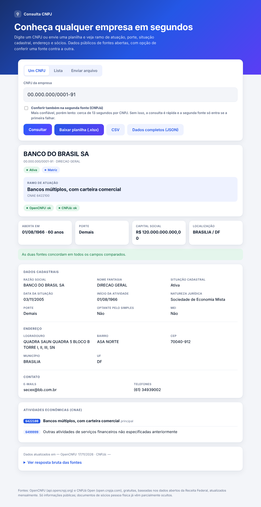

# Consulta CNPJ

[](https://github.com/Wally-SC/consulta-cnpj/actions/workflows/pages.yml)

Ferramenta de consulta de CNPJ em lote, feita para quem **não programa**. A pessoa abre a página, digita um CNPJ ou envia uma planilha, e recebe de volta o **porte**, o **ramo de atuação**, a **situação cadastral**, o endereço e outros dados públicos de cada empresa.

**Acesse online:** https://wally-sc.github.io/consulta-cnpj/

> A página roda inteira no navegador. Não há servidor, instalação nem cadastro. Também funciona como arquivo único: basta baixar o `index.html` e abrir com dois cliques.



## Sumário

- [Para quem é](#para-quem-é)
- [Como usar](#como-usar)
- [Formatos de arquivo aceitos](#formatos-de-arquivo-aceitos)
- [O que vem na planilha de saída](#o-que-vem-na-planilha-de-saída)
- [De onde vêm os dados](#de-onde-vêm-os-dados)
- [Modo rápido e modo conferido](#modo-rápido-e-modo-conferido)
- [Privacidade e LGPD](#privacidade-e-lgpd)
- [Limitações conhecidas](#limitações-conhecidas)
- [Como funciona por dentro](#como-funciona-por-dentro)
- [Desenvolvimento](#desenvolvimento)
- [Publicação no GitHub Pages](#publicação-no-github-pages)
- [Trocando a fonte de dados](#trocando-a-fonte-de-dados)
- [Roadmap](#roadmap)
- [Licença e avisos](#licença-e-avisos)

## Para quem é

Para equipes comerciais, de crédito, de cadastro ou de compras que recebem listas de CNPJs e precisam, uma vez por mês ou com a frequência que for, saber **que tipo de empresa** está por trás de cada número: se está ativa, qual o tamanho, em que setor atua. Em vez de consultar um CNPJ de cada vez em um site, a pessoa sobe a planilha e baixa a mesma planilha enriquecida.

## Como usar

A página tem três abas.

### 1. Um CNPJ

1. Digite o CNPJ (a máscara `00.000.000/0000-00` é aplicada sozinha).
2. Clique em **Consultar**.
3. Veja o ramo de atuação em destaque, a situação, o porte, o endereço, os contatos, as atividades secundárias e os sócios.
4. Se quiser, baixe o resultado em planilha.

Nesta aba as **duas fontes** são consultadas ao mesmo tempo e os campos em que elas discordam ficam marcados.

### 2. Lista

Cole vários CNPJs, um por linha ou separados por vírgula. O resultado vem em tabela e em planilha.

### 3. Enviar arquivo

Arraste a planilha para a área tracejada ou clique para escolher o arquivo.


O sistema encontra sozinho a coluna do CNPJ, mostra quantos CNPJs achou, estima o tempo e, ao clicar em **Consultar**, mostra um resumo e uma prévia:


Depois é só clicar em **Baixar planilha (.xlsx)**. A planilha devolvida **mantém todas as colunas da planilha original** e acrescenta as informações das empresas ao lado.

Para testar, use os arquivos da pasta [`exemplos/`](exemplos/) (CNPJs de empresas de capital aberto).

## Formatos de arquivo aceitos

| Formato | Como é lido |
|---|---|
| `.xlsx` / `.xlsm` | Primeira aba da planilha. A coluna com mais CNPJs válidos é usada. Números e datas das outras colunas são preservados. |
| `.csv` | Delimitador `;`, `,` ou tab detectado automaticamente; aspas tratadas; UTF-8 ou Windows-1252 (padrão do Excel brasileiro). |
| `.txt` | Se for uma lista (um CNPJ por linha ou texto corrido), todos os CNPJs encontrados são usados. Se for tabular (`;` ou tab em todas as linhas), é tratado como CSV. |
| `.xls` | **Não aceito** (Excel antigo). A tela orienta a salvar como `.xlsx` ou `.csv`. |

Detalhes úteis:

- **Cabeçalho:** se a primeira linha não tiver CNPJ na coluna escolhida, ela é tratada como cabeçalho e mantida.
- **Zero à esquerda perdido:** o Excel guarda CNPJ numérico sem o zero inicial (por exemplo `3982597000105`). Valores com 12 ou 13 dígitos são completados e só são aceitos se os dígitos verificadores baterem.
- **Validação:** todo CNPJ passa pelo cálculo dos dígitos verificadores antes de qualquer consulta. Sequências como `11.111.111/1111-11` são recusadas.
- **Duplicados:** o mesmo CNPJ em várias linhas é consultado uma vez só, e o resultado é repetido em cada linha.
- **Linhas sem CNPJ:** continuam na planilha de saída, com a observação "Sem CNPJ válido nesta linha".
- **Tamanho máximo:** 20 MB por arquivo.

## O que vem na planilha de saída

A aba **Resumo** traz as colunas originais, seguidas de:

| Coluna | Conteúdo |
|---|---|
| CNPJ (formatado) | `00.000.000/0001-91` |
| Razão social / Nome fantasia | Como consta na base da Receita |
| Situação cadastral | Ativa, Baixada, Suspensa, Inapta, Nula |
| Tamanho da empresa (porte) | Microempresa, Empresa de Pequeno Porte ou Demais; recebe "(MEI)" quando aplicável |
| Setor (aprox.) | Seção do CNAE (Comércio, Indústria de transformação, Saúde e assistência social etc.) |
| Área de atuação (CNAE principal) | Descrição da atividade principal, por exemplo "Comércio varejista de carnes - açougues" |
| CNAE | Código da atividade principal |
| Município / UF | Localização do estabelecimento |
| Capital social (R$) | Número formatado como moeda |
| Aberta em | Data de início da atividade (dd/mm/aaaa) |
| Simples / MEI | Simples Nacional, MEI ou Não |
| Observação | Divergências entre fontes, motivo da situação, "Não encontrado", "Não consultado" |

A aba **Dados completos** traz uma linha por CNPJ com todos os campos: endereço, contatos, CNAEs secundários, natureza jurídica, sócios, fontes consultadas e erros.

Também é possível baixar um **CSV** (separador `;`, com BOM para abrir corretamente no Excel, e proteção contra injeção de fórmulas) e um **JSON** com a resposta bruta das duas fontes, útil para conferir e ajustar o sistema.

### Sobre o "Setor (aprox.)"

É derivado da divisão do CNAE principal (os dois primeiros dígitos), seguindo as seções oficiais do CNAE (A a U). É uma classificação ampla, pensada para agrupar; a **Área de atuação** é a descrição exata da atividade.

## De onde vêm os dados

A Receita Federal publica a base completa do CNPJ como **dados abertos**, atualizada mensalmente. Esta ferramenta consulta duas APIs públicas e gratuitas que se baseiam nessa base:

| Fonte | Endereço | Papel | Observações |
|---|---|---|---|
| **OpenCNPJ** | `api.opencnpj.org/{cnpj}` | Fonte principal (rápida) | Sem chave. Traz endereço, CNAEs, porte, capital, Simples/MEI e sócios. |
| **CNPJá Open** | `open.cnpja.com/office/{cnpj}` | Complemento e conferência | Sem chave. Limite de **5 consultas por minuto** por IP. Pode responder 402 para empresas abertas há pouco tempo. |

Como as duas partem da mesma base mensal, **concordar não prova que o dado está certo**; mas **divergir é um bom alerta** de que vale conferir. Por isso a ferramenta compara os campos e lista as divergências.

Regras da mescla:

1. O valor vem da OpenCNPJ; se estiver vazio, da CNPJá.
2. A comparação ignora acentos, maiúsculas e pontuação (`S.A.` e `SA`, `70040-912` e `70040912` são iguais).
3. A descrição do CNAE só gera alerta se o **código** também divergir (os textos variam entre fontes).
4. O CNAE da CNPJá vem como número e perde o zero à esquerda (`600001`); ele é normalizado para 7 dígitos (`0600001`) antes de comparar.
5. Listas (e-mails, telefones) são unidas sem repetição.

## Modo rápido e modo conferido

| | Rápido (padrão em lote) | Conferido |
|---|---|---|
| Fontes | OpenCNPJ; CNPJá só se a primeira falhar | As duas, sempre |
| Velocidade | Rápida: 4 consultas em paralelo (não medi o ritmo real com as APIs) | Cerca de **13 s por CNPJ**, por causa do limite da CNPJá |
| Divergências | Não compara | Lista e marca no resultado |
| Quando usar | Triagem e listas grandes | Listas pequenas em que a confiança importa |

Ative o modo conferido marcando **"Conferir também na segunda fonte (CNPJá)"**. Antes de consultar, a tela estima o tempo total. Em caso de erro 429 (limite atingido), a consulta espera e tenta de novo automaticamente.

## Privacidade e LGPD

- **Tudo roda no seu navegador.** O arquivo enviado não vai para nenhum servidor do projeto: ele é lido localmente.
- Os únicos dados que saem do navegador são **os números de CNPJ**, enviados às duas APIs públicas citadas acima.
- Nada é gravado, nem em cookie, nem em armazenamento local, nem em banco de dados.
- Os dados exibidos são **públicos** (base aberta da Receita Federal). Os documentos de sócios pessoa física já vêm parcialmente ocultos na origem (`***345856**`) e a ferramenta não tenta reconstruí-los.
- Se a planilha original tiver dados pessoais em outras colunas, eles permanecem no seu computador e voltam na planilha de saída, que é gerada localmente.

## Limitações conhecidas

- **Defasagem:** os dados são mensais; uma empresa aberta ou alterada neste mês pode ainda não constar.
- **Acesso direto do navegador (CORS):** a página chama as APIs diretamente. Se alguma delas bloquear chamadas feitas por páginas web, a tela avisa. A alternativa prevista é empacotar a ferramenta como programa de Windows (ver [Roadmap](#roadmap)).
- **Limite de volume da OpenCNPJ:** a informação de que ela suporta volume alto vem de comparações de terceiros e não foi confirmada por testes de carga aqui. Em listas muito grandes, observe o primeiro lote.
- **Campos da CNPJá:** o mapeamento foi escrito a partir da documentação pública e de respostas de exemplo. Se algum campo vier vazio, o JSON bruto (botão "Dados completos") permite ajustar rapidamente.
- **Setor aproximado:** ver a seção acima.
- **Excel antigo (`.xls`)** não é lido.
- **Não substitui certidão oficial.** Para fins legais, emita o Comprovante de Inscrição e de Situação Cadastral no site da Receita Federal.

## Como funciona por dentro

É um **único arquivo HTML** (`index.html`) sem dependências, sem build e sem bibliotecas externas. Isso é proposital: a pessoa final só precisa de um arquivo.


O código fica entre os marcadores `CORE_START` e `CORE_END` (lógica pura, sem acesso à página) e a interface vem depois:

| Parte | Responsabilidade |
|---|---|
| Validação | `validaCnpj`, `extraiCnpjs`, `achaCnpjsEmTexto`, `cnpjDeCelula` |
| Normalização | `normOpen`, `normCnpja`: levam cada fonte ao mesmo formato interno |
| Mescla | `mescla`: prioridade, comparação tolerante e relatório de divergências |
| Rede | `buscaJson` (timeout, 402/404/429, retry), `consultaLote`, `processaLote` |
| Arquivos | `parseCsv`, `planoDeTabela`, `planoDeTexto`, `leXlsx`, `lerArquivoEnviado` |
| XLSX | Leitor e gravador **escritos à mão** (ZIP + XML), sem biblioteca: `leZip`, `leXlsx`, `geraXlsx`, `zipStore` |
| Saída | `resumoLinha`, `montaAbasSaida`, `linhaPlanilha`, `geraCsv`, `setorCnae` |

A leitura de XLSX usa `DecompressionStream` do próprio navegador. A planilha gerada tem cabeçalho congelado, filtro, larguras de coluna e formato de moeda, e foi validada com uma leitora independente (openpyxl).


A página acompanha o tema claro ou escuro do aparelho e se adapta a telas pequenas.

## Desenvolvimento

Requisitos: **Node 18 ou superior** (apenas para os testes; a ferramenta em si não usa Node).

```bash
git clone https://github.com/Wally-SC/consulta-cnpj.git
cd consulta-cnpj
npm test            # 13 testes, sem dependências
npm run exemplos    # recria os arquivos de exemplo em exemplos/
```

Para usar localmente, abra o `index.html` no navegador.

Estrutura:

```
consulta-cnpj/
├── index.html              # a ferramenta inteira
├── exemplos/               # exemplo.xlsx, exemplo.csv, exemplo.txt
├── tests/
│   ├── core.test.js        # testes do núcleo (node:test)
│   └── helpers.js          # extrai o núcleo do index.html
├── scripts/gera-exemplos.js
├── docs/img/               # imagens deste README
└── .github/workflows/pages.yml
```

Os testes cobrem validação de CNPJ, recuperação de zero à esquerda, CSV com aspas, planilha com e sem cabeçalho, TXT livre, setor por CNAE, mescla (sem divergência falsa e com divergência real), ida e volta de XLSX, montagem da planilha de saída, proteção do CSV contra fórmulas e leitura dos arquivos de exemplo. As chamadas de rede não são testadas aqui (dependem das APIs externas).

## Publicação no GitHub Pages

O workflow [`pages.yml`](.github/workflows/pages.yml) roda a cada push na branch `main`: executa os testes e, se passarem, publica o `index.html` e os exemplos.

Configuração (já feita neste repositório): **Settings → Pages → Source: GitHub Actions**.

Endereço: https://wally-sc.github.io/consulta-cnpj/

Os arquivos de exemplo ficam em `/exemplos/` no mesmo endereço.

## Trocando a fonte de dados

A migração para uma fonte oficial paga (por exemplo, a API de consulta CNPJ do Serpro) toca poucos pontos do código:

1. `URL_OPEN` / `URL_CNPJA`: endereços das fontes.
2. `normOpen` / `normCnpja`: funções que convertem a resposta para o formato interno. Uma nova fonte precisa de uma função `normNova` que devolva os mesmos campos.
3. `consultaUm` e `consultaLote`: onde cada fonte é chamada e mesclada.

Como a API oficial exige credenciais, o ideal é chamá-la por um pequeno servidor intermediário, para não expor a chave no navegador.

## Roadmap

- [ ] Teste real com as duas APIs no endereço publicado (verificar CORS e limites).
- [ ] Programa de Windows com duplo clique, se o navegador bloquear alguma fonte.
- [ ] Migração para a API oficial do Serpro.
- [ ] Atualização mensal automática, se o uso mensal virar rotina.
- [ ] Filtros e ordenação na tela de resultados em lote.

## Licença e avisos

Este repositório **não tem licença de uso**: todos os direitos são reservados ao autor. Para permitir o uso por terceiros, adicione uma licença.

Os dados exibidos pertencem às suas fontes (Receita Federal, OpenCNPJ, CNPJá) e são fornecidos sem garantia. Confirme informações críticas na Receita Federal.
